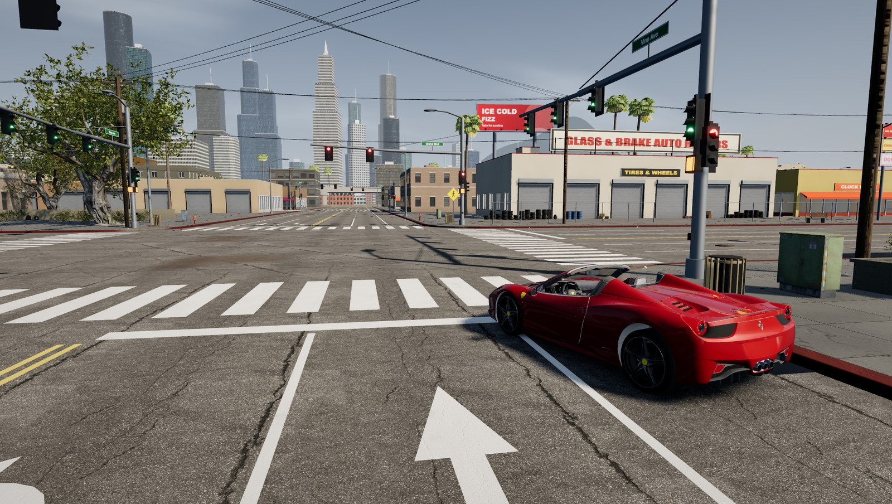
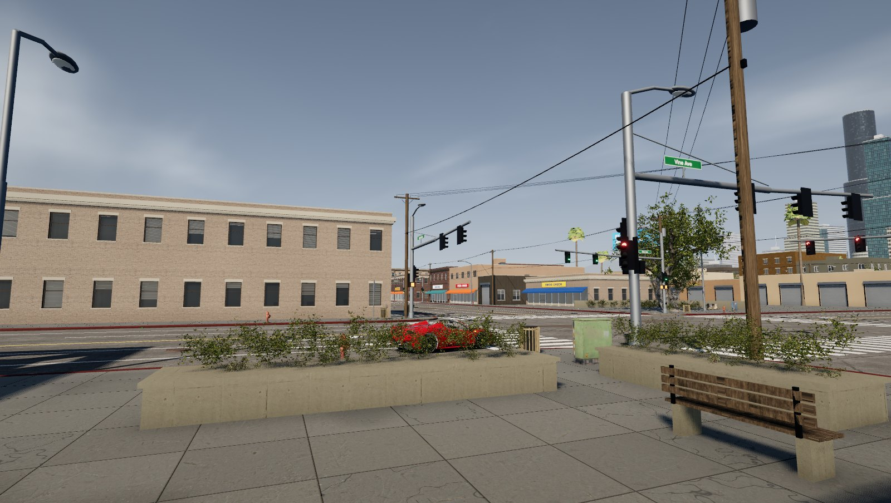

# Downtown Drive

A browser-based 3D driving game set in a small, dense Los Angeles–style city block, built to
reproduce the look of a sunny-afternoon AAA open-world screenshot as closely as practical in WebGL.
You can drive from a chase camera or the driver's seat, get out (E), and walk, run, jump, kneel and
fight on foot as a motion-captured, photo-textured 40-something character. You can also take any car
in traffic: its driver pulls up, and it becomes yours to drive.





Stack: **Three.js r186** (WebGL2, PBR), **pmndrs/postprocessing** + **N8AO**, **Rapier** physics
(WASM), **Vite**. Assets are CC0 Poly Haven scans/textures processed with **Blender 4.4**, a CC-BY
Ferrari 458 model, a Microsoft Rocketbox (MIT) human with Rocketbox and CMU motion capture, and a lot
of procedural geometry, plus textures painted on canvas at startup.

## Quick start

```bash
npm install
npm run dev          # http://localhost:5173
```

All runtime assets are already in `public/assets` (about 135 MB). You only need the asset scripts
to regenerate them:

```bash
npm run fetch-assets     # re-download Poly Haven / Ferrari sources (skips existing files)
npm run process-assets   # rebuild decimated GLBs with Blender (BLENDER=/path/to/blender)
```

Production build: `npm run build && npm run preview`.

Requirements: Node 18+, and a desktop browser with WebGL2 and a reasonably strong GPU. It was
developed and measured on an Apple M2 in Chrome.

## Deploying to GitHub Pages

The game is a static site, so GitHub Pages can host it. `.github/workflows/deploy-pages.yml`
builds and publishes it on every push to `main`.

1. One-time setup: on GitHub, open **Settings → Pages → Build and deployment** and set **Source** to
   **GitHub Actions**.
2. Push to `main`, or run the workflow from the **Actions** tab. The site is published at
   `https://<user>.github.io/<repo>/`; for this repository that is
   <https://abhi0303.github.io/high-graphics-games/>.

The workflow builds with `BASE_PATH=/<repo>/`, because a project site is served from that subpath.
All asset URLs in the code derive from `import.meta.env.BASE_URL`, so nothing else changes. To
check a Pages build locally:

```bash
BASE_PATH=/high-graphics-games/ npm run build
npx vite preview --base /high-graphics-games/   # http://localhost:4173/high-graphics-games/
```

Sizes and limits:
- The built site is about 177 MB, under the Pages 1 GB limit.
- No single file is near GitHub's 100 MB file limit; the largest is the 18 MB default sky HDRI.
- A first visit downloads about 150 MB (126 files, measured), after which the browser caches it.
  Pages has a soft limit of 100 GB of traffic a month, roughly 650 first visits.
- Pages hosts static files only. That is enough here: physics runs in the browser (WASM) and
  nothing needs a server.

## Controls

Driving:

| Key | Action |
| --- | --- |
| W / ↑ | Accelerate |
| S / ↓ | Brake, then reverse |
| A / D, ← / → | Steer |
| Space | Handbrake |
| E | Get out (below ~9 km/h) |
| C | Cycle camera: chase → driver (first person, Ferrari only) → far chase → bumper → cinematic |
| L | Headlights: low beam → high beam → off |
| Mouse drag / wheel | Orbit / zoom the camera (in the driver view: look around) |
| R | Reset the car to the start position |
| H / F / U | Toggle help / performance stats / km/h vs mph |

On foot (a controls hint appears when you get out):

| Key | Action |
| --- | --- |
| W A S D | Move (relative to the camera) |
| Shift | Run |
| Space | Jump: a hop when standing, a leap when running. In front of a low wall or planter (up to 1.3 m) it clears it |
| Ctrl | Kneel / stand up |
| Left mouse | Punch (click again to chain left/right) |
| Right mouse (hold) | Block |
| Mouse / wheel | Camera (click once to capture the mouse, Esc releases it) / zoom |
| C | Camera: third person → over the shoulder → far |
| E | Walk to the nearest car's door and get in: the Ferrari, a car you left parked, or any traffic car (it pulls up first) |

Curbs, kerbs and single steps up to 36 cm are walked over automatically.

## URL options

| Parameter | Effect |
| --- | --- |
| `?quality=ultra\|high\|medium` | Render preset (default `high`) |
| `?traffic=N` | Number of AI vehicles (default 28, `0` disables traffic) |
| `?capture` | Hide the HUD, freeze traffic lights, deterministic frame for screenshots |
| `?view=reference\|rear\|side\|front\|street\|sky` | Camera preset used in capture mode |
| `?sky=kloofendal_48d_partly_cloudy_puresky_4k` | Alternative HDRI sky |
| `?nopost` | Debug: plain forward render without post-processing |
| `?onfoot` | Start by getting out of the car |

## Tooling

```bash
npm run screenshot -- --out shot.png --w 2160 --h 1220 --view reference   # headless Chrome on the real GPU
npm run drive-test -- --out drive-test                                    # scripted drive with key events
npm run steering-test      # A/D/arrow keys at 15/40/80 km/h and in reverse: trajectory, physics + visual wheel angle agree
npm run skid-test          # tyre marks: none for a light brake, present for hard braking / handbrake, bounded buffer
npm run traffic-test       # AI traffic: keeps moving, no overlaps, no sideways motion, no red-light running
npm run interaction-test   # player blocks an AI car (it stops), rams one (stable physics, AI stays in lane), stands in its lane on foot (it stops)
npm run camera-test        # driver view: blended switches (no snaps, never through the bodywork), seat eye, same controls, head motion, mouse look
npm run character-test     # seated driver (hands on rim, feet on pedals), animated exit/enter + door, walk/run (foot sliding),
                           # jump (no double jump), kneel, punch timing/hits/combos, block, blocked states
```

Both scripts expect the dev server to be running. They use `puppeteer-core` with the locally
installed Chrome (`CHROME_PATH` overrides the path).

## Project structure

```
src/
  main.js                 boot, fixed-step loop (120 Hz physics + interpolation), dynamic resolution
  config.js               quality presets, URL options
  core/   renderer.js     WebGLRenderer, EffectComposer: MSAA → N8AO → bloom → exposure/ACES/grade
          assets.js       cached GLTF/Draco, texture, HDR loading
          input.js        keyboard / mouse
  world/  layout.js       street grid, blocks, intersections, car start (single source of truth)
          environment.js  HDRI sky (sun extracted + clamped), calibrated sun, shadows, fog, haze dome, clouds
          materials.js    PBR library + shader injections (anti-tiling asphalt, road wear map,
                          sidewalk slab seams, worn paint, facade weathering)
          roads.js        ground, sidewalks + rounded curb returns, markings, procedural wear map
          buildings.js    procedural buildings: recessed windows, storefronts, signs, awnings, rooftops
          windows.js      interior-mapped window glass (fake rooms with parallax, blinds, lights)
          cityPlan.js     lot subdivision, building styles/heights, hero lots matching the reference
          props.js        signals (live cycle), poles + wires, lights, signs, fences, clutter, litter
          vegetation.js   scanned trees with 4 LOD tiers incl. baked impostors, procedural fan palms, bushes
          skyline.js      downtown towers, mid-rise filler ring, freeway, hills
          signs.js        canvas-painted signage atlas (fictional businesses)
          geo.js, noise.js
  vehicle/ physics.js     Rapier world (ground half-space) + ray-cast vehicle (engine, ramped brakes, handbrake,
                          drag, downforce), sphere casts for cameras
           car.js         Ferrari model, re-authored materials (incl. black leather cabin), wheel steer/spin/
                          suspension, headlight beams, DRLs, tail / brake / reverse lamps, live tachometer,
                          driver's door split out of the merged body and hinged
           mirror.js      interior rear-view mirror: off-axis render from the mirrored eye
           drivable.js    any car the player can use (Ferrari or commandeered traffic): physics + interpolated pose,
                          door / seat points; physics.js derives a vehicle spec from a traffic model's metadata
           skidMarks.js   tyre marks: ring-buffer strip mesh fed by Rapier contact points and tyre slip
           reflectionProbe.js  dynamic cube-map reflections for the car
  traffic/ laneGraph.js   lanes + Bézier intersection connectors derived from the road layout
           traffic.js     AI drivers (IDM following, signals, left-turn yielding, lane-pair staggering,
                          forward-cone avoidance incl. the player), kinematic Rapier bodies, instanced rendering
           trafficModels.js  loads standardised vehicle GLBs, paint recolouring, per-instance brake glow
  character/ character.js  Rocketbox avatar, PBR skin/clothes/hair, animation layers, speed-matched locomotion, blinking
             onFoot.js      Rapier kinematic character controller with own step-up / footprint support, context jump,
                            state machine (move/jump/kneel/fight)
             driver.js      seated pose fitted to the car: H-point, recline, two-bone IK hands on the rim / feet on pedals
             player.js      driving ⇄ on foot for any car, animated exit / walk-to-door / enter sequences, input routing
  camera/  cameraRig.js   chase + driver (first-person) + on-foot cameras, blended switching, collision, presets
  ui/      hud.js
scripts/   fetch-assets.mjs, process-assets.mjs, screenshot.mjs and the *-test.mjs gameplay tests
tools/     process_tree.py, decimate_prop.py, process_vehicle.py (Blender), inspect_gltf.py,
           build_character.py + retarget_lib.py (Blender: character GLB, world-space mocap retargeting)
```

## Rendering notes

- **Lighting calibration.** The HDRI's sun is located, clamped out of the image-based lighting and
  replaced by a shadow-casting directional light aligned to it. Sun intensity is derived from the
  sky's measured radiance (about 4:1 sun-to-sky irradiance, as on a clear day), and exposure is
  derived from that, so the numbers are not hand-picked.
- **Shadows.** A 4096² PCF soft shadow map follows the camera's focus and is texel-snapped to avoid
  shimmering. N8AO supplies contact and architectural ambient occlusion, plus a baked AO decal
  under the car.
- **Atmosphere.** Exponential fog and a sky haze dome both use the HDRI's measured horizon colour,
  so distant towers fade into the sky behind them. Procedural fBm clouds drift slowly.
- **Surfaces.** Asphalt uses two-scale anti-tiling sampling, a world-space wear map (oil drips in
  lane centres, polished wheel paths, patch repairs, crack sealant) and boosted aggregate contrast.
  Road paint follows the asphalt relief and wears away by noise. Sidewalks get 5 ft slab seams,
  per-slab tint, hairline cracks and stains.
- **Buildings.** Windows are real openings with reveals, sills and frames. The glass is
  interior-mapped, so rooms show depth and parallax under physically based sky reflections. Tower
  facades are mip-mapped canvas texture sets with separate glass/frame roughness and metalness.
- **Car.** Clear-coat paint, glass, rubber and machined rims are re-authored on the model. A cube
  reflection probe (buildings, street, signals, sky) refreshes while driving and is PMREM-filtered
  by three.
- **Level of detail.** Trees use a hero LOD, LOD0, LOD1 and a baked impostor tier, swapped by
  distance. Buildings are batched per city block and material, and repeated props are instanced.
  Distant geometry is texture-based.
- **Vehicle lights.** The player car has two real headlight spot beams (low/high, L key) that follow
  the car, emissive projector lamps and daytime-running LEDs, and tail lamps that brighten when
  braking. Reverse lamps come on in reverse. Lamps change intensity only, so no shaders recompile.
- **Tyre marks.** Marks come from Rapier's per-wheel contact points. A tyre marks the road when its
  friction impulse saturates, when it slides sideways, under hard braking (brake pressure ramps in,
  so a light tap leaves nothing) or when a rear wheel is locked by the handbrake. Marks live in a
  6,000-quad ring buffer and fade out over 45 s.
- **Traffic.** 28 AI vehicles (14 licensed models) follow a lane graph built from the road layout:
  - car-following uses the Intelligent Driver Model;
  - they obey the traffic-light cycle and yield on permissive left turns;
  - turns from neighbouring lanes are staggered, and a forward cone also watches the player;
  - bodies follow both axles along the lane, so they never slide sideways;
  - each car is a kinematic Rapier body, so the player collides with it and it stops for the player.

  For rendering, LOD0 keeps clear-coat paint and the large textures. Everything else, and the whole
  vehicle at LOD1, is baked into one vertex-coloured mesh per model. With per-instance paint colour,
  brake glow and frustum culling, 28 cars cost about 90 draw calls.

- **Driver view.** A first-person camera at the measured eye point of the 458's seat (the seat,
  headrest and windshield header were measured from the meshes). It is rigid to the chassis, so it
  carries the suspension's pitch and roll, plus a critically damped head offset from longitudinal and
  lateral acceleration (a few cm) and a gaze that leans into corners. Mouse look is clamped and
  recentres. Every camera switch blends position, orientation and field of view over 0.75 s, along an
  arc over the open cabin when entering or leaving it. The near plane drops to 6 cm only in the cabin.
  The cabin has black leather/Alcantara materials, a working tachometer with gear/speed readout, and a
  real rear-view mirror (a 384×90 off-axis render from the mirrored eye at a quarter of the frame rate).
- **Character.** The avatar is Microsoft Rocketbox *Male_Adult_05* (photo-sourced 2K head/body
  textures, 80-bone Biped rig, ARKit blink shapes). `tools/build_character.py` converts the
  specular maps to roughness, keeps only the blink shapes, and retargets every clip in world space:
  - Rocketbox mocap for idle, walk, run and sitting (same rig, root travel removed from the cycles);
  - CMU mocap (cgspeed BVH) for jump, kneel and boxing, retargeted through a T-pose correspondence.
    Punches are aligned and timed at full arm extension; the gameplay hit test uses that moment.
  In the game, walk and run are phase-synchronised and their playback rate follows the measured clip
  speed, so planted feet move at about 5 % (walk) and 8 % (run) of body speed. Movement uses a Rapier
  capsule character controller (auto-step for curbs, snap to ground, slide).
- **Movement over the city.** The capsule controller has its own step-up. Ground probes just ahead of
  the feet, and into anything the capsule is pressing against (so a curb met at a shallow angle
  counts too), lift it onto any walkable top up to 36 cm. It then stands on the highest support under
  its footprint, so it never sinks into a surface or slides back off a curb edge. The visible body
  eases over steps up and down instead of popping. Space in front of a wall up to 1.3 m tall gives
  the jump enough height to clear it.
- **Jumping.** Jumps are ballistic (physics), with no double jump.
  - Standing or walking: a short forward hop (CMU "jump small forward").
  - Running: a leap (CMU "run jump over") that keeps the running speed.
  - Take-off comes about 0.1 s after the key, so the jump feels immediate.
  - The flight clip is stretched to the time actually left in the air.
  - Landing goes straight back into the run when you keep moving.
- **Any car.** Every traffic car can be entered:
  - The AI driver pulls up when you press E nearby, and the character walks to its driver's door.
  - The car leaves the AI simulation. A dynamic ray-cast vehicle built from the model's metadata
    (mass, power, brakes and suspension by category; wheel positions; body shapes) replaces its
    kinematic body.
  - Traffic keeps drawing it through its instancing, from the physics pose, with real suspension,
    steering, wheel spin and brake lights.
  - Cars you leave stay parked and physical. AI drivers treat them, like the Ferrari, as obstacles.
  - The chase cameras pull back for long vehicles.
- **Getting in and out.** The driver's door is split from the car body at load time and swings on a
  hinge. Exiting: the door opens, the legs swing out, he stands up and steps out, the door shuts. Entering:
  he walks to the door, sits down backwards into the seat, swings his legs in and the door shuts. While
  driving, two-bone IK keeps his hands on the rim (they follow the wheel up to 30° and then let it
  slide through) and his feet on the pedals. In the driver view the head is hidden, because the
  camera is the eyes.

## Performance (measured, Apple M2, Chrome, headless with GPU)

| Resolution | Preset | FPS |
| --- | --- | --- |
| 1920×1080 | medium (half-res AO, 2× MSAA) | 60 (vsync cap) |
| 1920×1080 | high (half-res AO, 4× MSAA), default | ~46 |
| 1600×904 | ultra (full-res AO, 4× MSAA) | ~56 |
| 2160×1220 | ultra | ~34 |
| 1280×720 | high, **28 traffic vehicles** | ~44 (~50 with `?traffic=0`) |
| 1280×720 | high, 28 vehicles, after dynamic resolution settles: chase / driver view / on foot | ~52–60 / ~49 / ~57 |

The character costs no measurable frame time (skinned mesh, shadows and sheen materials on or off
measured the same 16.6 ms vsync-capped frame). The rear-view mirror costs about 0.9 ms per frame
on average in the driver view.

Roughly 470 draw calls and 5.4 M triangles per frame, including the shadow pass. In interactive
mode, dynamic resolution lowers the pixel ratio (down to 60 %) only after the frame rate has stayed
below 45 fps for two 2-second windows. It never climbs back within 30 s of a drop, and it resizes
before a frame renders. An earlier version resized after rendering and could oscillate, which showed
up as a blink every 2–3 seconds.

## Honest comparison with the reference

The composition, time of day, colour balance and the main elements of the reference are matched:
the intersection, mast-arm signals, utility poles and wires, the fenced auto-repair forecourt with a
roof sign, billboard, pole signs, palms, a big street tree, the skyline in haze, the freeway, red
curbs, the utility cabinet and the bin. It does **not** reach the fidelity of the reference, which is
GTA V with heavy graphics mods. The main gaps:

- **Assets.** The buildings are procedural, so their architecture is simpler and cleaner than
  hand-made assets, and the far-side storefronts lack the reference's density of signage and clutter.
- **Car.** It is a 458 *Spider*, an open-top variant. The reference car is a coupé with a widebody kit.
- **Foliage.** The scanned trees had to be heavily thinned for real time, so canopies are less lush.
  The palms are procedural.
- **Lighting.** There is no global illumination or bounce light beyond IBL and AO, and no
  screen-space reflections on the road.
- **Life.** There are no NPC pedestrians. Only the player walks, and traffic stops for him.
- **Character.** The avatar has a moderate polygon count (7.8k triangles). Its realism comes from
  the photo textures, and silhouettes such as cuffs and fingers are visibly faceted up close. Hair is
  alpha-tested cards and the short spiky style shows its card edges from above. There is no
  subsurface scattering, only a sheen approximation. The motions are mocap, but:
  - there are no turn-in-place, strafe or start/stop transition clips;
  - turning is a rotation of the whole body;
  - the fight moves are boxing clips (no hit reactions, no NPC opponents; punches hit walls, poles
    and vehicles);
  - the enter/exit sequence is assembled from chair sit/stand clips plus scripted root motion, so the
    legs pass through the door sill for a moment, and there is no door-handle hand IK;
  - traffic cars have no opening doors or modelled interiors, so the character sits in through the
    closed door, isn't shown while driving them, and they have no driver view. The AI drivers are not
    modelled either, so there is no pulling anyone out, and a commandeered car doesn't rejoin traffic;
  - hurdles up to 1.3 m are cleared with a physics jump plus the jump animation, not a dedicated
    hands-on vault/climb animation;
  - there is no foot IK on uneven ground. The streets are flat, and curbs are handled by the
    controller's auto-step, not by the feet.
- **Traffic.** The vehicles are community models of mixed quality. The Marcopolo bus shows the
  model author's name on its destination sign. Far vehicles lose normal maps and clear coat (LOD1).
  AI cars are kinematic: a crash stops them but never knocks them around. Lane changes and parked
  cars aren't implemented. Headlight beams barely show on sunlit asphalt in daytime, as in reality,
  and are clearly visible in shade.
- **Textures.** JPEG with mipmaps and anisotropic filtering. KTX2/Basis compression is not set up yet.

## Assets and licences

See [ASSETS.md](ASSETS.md). No game files or proprietary assets are used, and every business name and
advert in the city is fictional.
